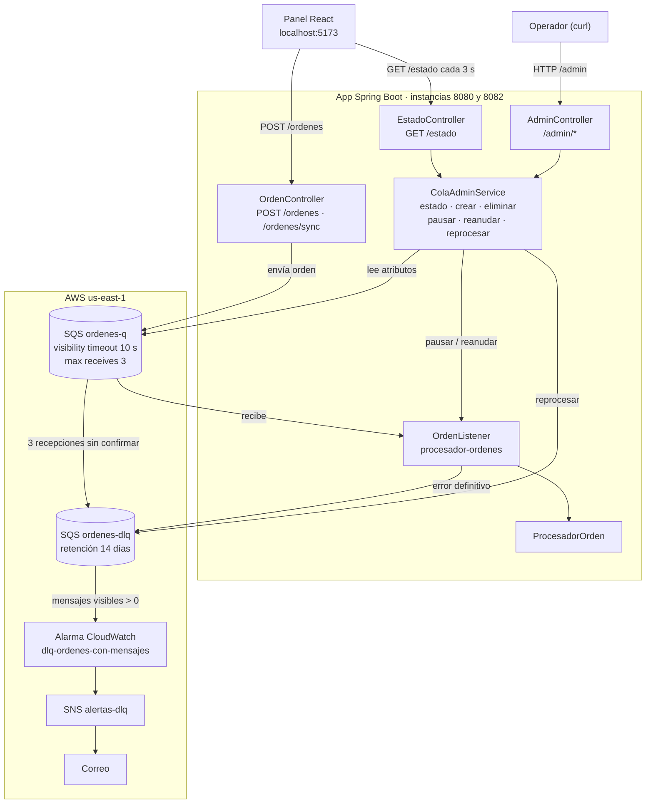

# Mensajería con Amazon SQS y SNS

## Arquitectura

## DLQ, reintentos y alertas

**1. ¿Diferencia entre *Visibility timeout* y *Message retention period*?**
El *visibility timeout* es el tiempo que un mensaje queda oculto tras ser recibido; si no se confirma, vuelve a la cola para otro intento (10 s en `ordenes-q`). El *retention period* es cuánto tiempo SQS guarda el mensaje antes de borrarlo, se procese o no.

**2. ¿Por qué el procesamiento no debe bloquear el flujo del pedido?**
En `/ordenes/sync` el usuario esperó ~2 s y recibió un error 500 cuando falló el servicio externo. En `/ordenes` respondió en ~0,6 s y la falla se manejó con reintentos en segundo plano, sin afectar al usuario.

**3. ¿Cómo trata el consumidor un error transitorio y uno definitivo? ¿Por qué distinguirlos?**
El transitorio no se confirma y se reintenta hasta 3 veces antes de pasar a la DLQ. El definitivo se envía directo a la DLQ, sin reintentos. Se distinguen porque reintentar solo sirve si el problema puede desaparecer.

**4. El mensaje de `prueba-ttl-q` expiró. ¿Fue a la DLQ?**
No. Al vencer la retención, SQS lo borra. La DLQ solo recibe mensajes que superan *Maximum receives*.

**5. ¿Qué ventaja tiene centralizar los nombres en `application.properties`?**
Se cambian en un solo lugar, sin tocar el código, y permite usar colas distintas por ambiente. También evita errores como consultar la cola equivocada.

**6. ¿Qué efecto tiene `max-concurrent-messages` en el tiempo total?**
Con 1, las órdenes se procesan de a una (~2 s cada una, ~20 s para 10). Con 10, se procesan en paralelo y el total bajó a ~13 s. Debe ir junto a `max-messages-per-poll`, que no puede ser mayor.

## Administración de colas

**1. Al detener una instancia, ¿se perdió alguna orden? ¿Por qué?**
No. Los mensajes viven en SQS, no en la instancia, y la otra instancia procesó los pendientes. Si una cae a mitad de una orden, el mensaje reaparece al vencer el *visibility timeout*.

**2. ¿Por qué ya no hace falta levantar un cluster?**
SQS es un servicio administrado: AWS opera los servidores y la disponibilidad. Para escalar basta con agregar consumidores.

**3. ¿Qué pasa con los mensajes mientras el listener está pausado? ¿Hasta cuándo se conservan?**
Quedan esperando en la cola sin procesarse. Se conservan hasta reanudar el listener o hasta que venza el *retention period* de la cola (4 días por defecto).

**4. ¿Qué ganas con tener esta lógica en un servicio y no repartida en varios controllers?**
Un solo lugar habla con SQS y los controllers lo reutilizan. Los cambios se hacen una vez y el código queda más fácil de mantener y probar.

**5. ¿Por qué una de las órdenes reprocesadas volvió a la DLQ?**
La de monto -5 tiene un error definitivo: el dato sigue siendo inválido. La de Cliente 1 tenía un error transitorio, y al desactivar `simular-fallo` se procesó bien.
